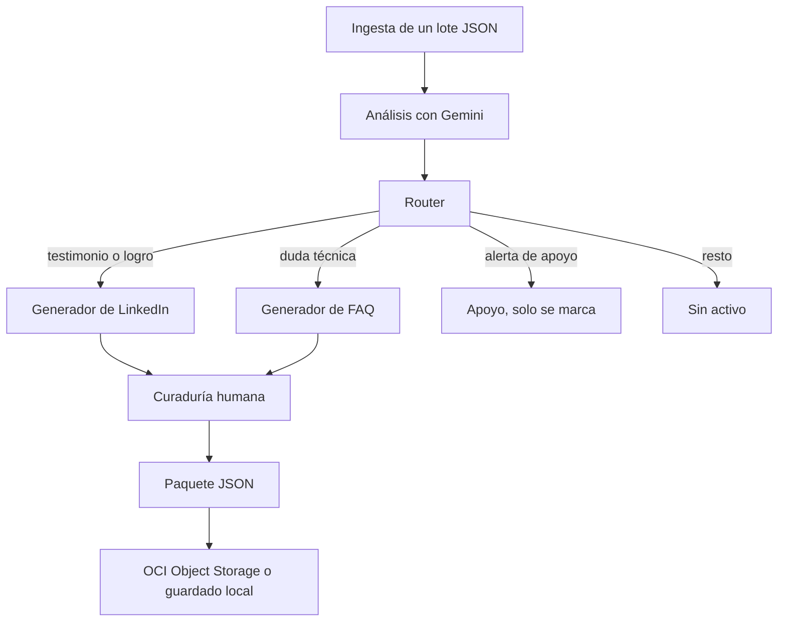
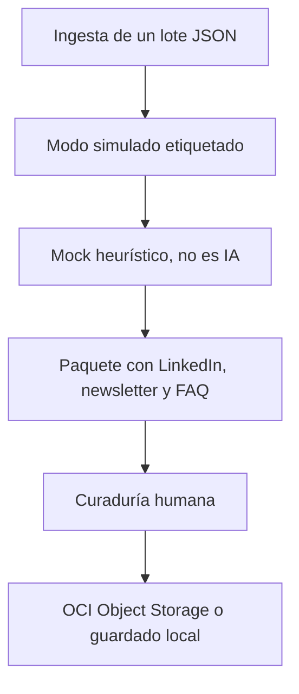

# CommunityLab — Motor Inteligente de Transformación y Distribución para Comunidades Digitales

> Demo desplegada: [CommunityLab en Streamlit](https://proyectohackathon-vmuqmx28sqeyagkyoebamt.streamlit.app/). Es una demo, no un entorno productivo.
>
> Acceso de evaluación: `admin` / `admin`, solo para la demo.

## Estado del proyecto

Este README describe la rama de integración. La demo desplegada sigue `main` y mostrará estos cambios cuando se fusione el PR revisado por el equipo. Demo Day: 27-oct-2026.

Stack actual: Python 3.12, Streamlit, Gemini mediante LangChain, Pydantic y el SDK de OCI. El pipeline real es una secuencia de funciones; no usa LangGraph.

## 1. Qué hace

CommunityLab recibe un lote JSON de interacciones simuladas de una comunidad, analiza sentimiento, temas y relevancia con Gemini, aplica un router y genera un post de LinkedIn y/o una FAQ. Un curador humano revisa, edita y decide; el paquete se guarda en OCI Object Storage o en un espejo local etiquetado.

## 2. Arquitectura

Flujo real:



El modo simulado no pasa por el router: reemplaza el análisis y la generación por un mock heurístico y arma un paquete con los tres bloques. Se muestra aparte para no mezclarlo con el flujo real:



## 3. Router y flujo

Reglas actuales del router:

- `alerta_apoyo` y `dificultades` van a `apoyo`: solo se marcan en el análisis, sin activo.
- `testimonio` y `logro` van a `post_linkedin` con sentimiento positivo o muy positivo; si no, van a `sin_activo`.
- `pregunta_tecnica` y `duda` van a `faq`.
- El resto solo va a `post_linkedin` con sentimiento muy positivo; si no, va a `sin_activo`.

El pipeline elige un candidato por ruta según la puntuación de relevancia. No hay ruta de newsletter.

## 4. Formatos y esquema del paquete

Formatos del MVP:

- `post_linkedin`: título, copy, canal recomendado, potencial de engagement y `estado_aprobacion`.
- `sugerencia_contenido_faq`: tema, origen, `status`, `pregunta`, `respuesta_sugerida` y `estado_aprobacion`. La pregunta y la respuesta las genera el LLM.
- `destaque_newsletter_semanal`: opcional en el esquema; no se genera en el pipeline real. El modo simulado sí puede incluir un bloque de newsletter con plantillas.

El esquema vive en `docs/esquema-paquete-distribucion.md`. El paquete que se sube lleva `almacenamiento_oci.bucket` y `almacenamiento_oci.ruta_objeto`; el `status` de la subida se devuelve en la respuesta. El ejemplo de `docs/` es ilustrativo; el contrato de subida es el de la sección 7.

## 5. Ejecución local con uv

Requisitos: Python 3.12 y `uv`.

```powershell
uv venv
uv pip install -r requirements.txt
.venv\Scripts\Activate.ps1
streamlit run app.py
```

En Linux o macOS, activa el entorno con `source .venv/bin/activate`.

No hay `pyproject.toml` ni `uv.lock`; por eso no se usa `uv sync`. La aplicación se abre en `http://localhost:8501`.

## 6. Secretos y configuración

No escribas valores reales en el README ni en el repositorio. Usa `.env` o `.streamlit/secrets.toml`, que no se versionan.

Nombres para ejecución local:

- Gemini: `GEMINI_API_KEY`, `GEMINI_MODEL`.
- OCI con perfil `DEFAULT`: `OCI_CONFIG_FILE`, `OCI_CONFIG_PROFILE`, `OCI_REGION`, `OCI_NAMESPACE`, `OCI_BUCKET`.
- OCI con credenciales explícitas: `OCI_USER`, `OCI_FINGERPRINT`, `OCI_TENANCY`, `OCI_KEY_CONTENT` o `OCI_KEY_FILE`.

Nombres para `st.secrets`:

- `[gemini]`: `api_key`, `model`.
- `[oci]`: `region`, `namespace`, `bucket`, `user`, `fingerprint`, `tenancy`, `key_content` o `key_file`.

En Streamlit Cloud usa `key_content`, no `key_file`. Las claves de `st.secrets` tienen prioridad sobre el entorno. En las guías usa `<region>`, `<namespace>` y `<bucket>`; `sa-santiago-1` puede aparecer solo como ejemplo de región.

El modelo de Gemini es configurable con `GEMINI_MODEL` o `[gemini] model`; el valor por defecto está en `communitylab/config.py`.

## 7. OCI: rutas y estados de guardado

La ruta sugerida es `activos/AAAA-semana-NN/paquete-distribucion.json`; el campo es editable en la vista. El archivo guardado lleva el `bucket` y la `ruta_objeto` reales; el `status` de la subida se devuelve en la respuesta.

Estados posibles:

- `guardado_con_exito`: el objeto se subió a OCI. `modo` es `OCI_Cloud_SDK` y `nube_real` es `true`.
- `ya_existe`: el objeto ya estaba en el bucket y no se sobrescribió.
- `error_al_guardar`: fallo al subir a OCI. No se cae a local en silencio.
- `guardado_local`: no hay credenciales válidas de OCI; el paquete se escribió en el espejo local `data/salida/oci_offline/`. `nube_real` es `false` y la vista muestra un aviso.

La sobrescritura está desactivada por defecto. Si se activa la casilla correspondiente, el objeto se reemplaza.

## 8. Despliegue en Streamlit Cloud

1. Crea la app desde el repositorio y la rama que quieras desplegar. La demo actual sigue `main`; los cambios de este README llegarán cuando se fusione el PR.
2. Usa `app.py` como entrypoint y Python 3.12.
3. En Secrets, pega las secciones `[gemini]` y `[oci]` con los nombres de la sección 6. En Cloud usa `key_content`, no `key_file`. Para OCI usa una clave de API dedicada y revocable (no tu perfil personal) y rótala al terminar el evento.
4. Despliega y revisa los logs de arranque.
5. Verifica el flujo: inicia sesión con la credencial de demo, carga un lote, ejecuta el pipeline real, revisa en Curaduría y guarda en OCI. Confirma `guardado_con_exito`; si ves `guardado_local`, faltan credenciales de OCI.

Streamlit Cloud instala las dependencias desde `requirements.txt`. El flujo con `uv` es para desarrollo local.

## 9. Límites conocidos y honestidad

- El modo simulado es heurístico y no es IA. La interfaz lo etiqueta como “Modo simulado (sin IA)” y muestra un aviso.
- El modo simulado no pasa por el router; usa `modules/mock_engine.py` y genera LinkedIn, newsletter y FAQ con plantillas.
- La newsletter no está implementada en el pipeline real; queda como roadmap. El modo simulado sí la incluye.
- La cuota de Gemini es gratuita y compartida, sujeta a cambios. El proyecto usa caché local y topes de llamadas.
- Las respuestas de FAQ y los testimonios con nombres requieren revisión humana. El diseño pide que el contenido se base solo en las interacciones de entrada.
- Las respuestas sugeridas de la FAQ pueden ser técnicamente incompletas o discutibles (en pruebas, una propuso una causa poco probable para un error de autenticación). No deben publicarse sin revisión técnica.
- Los datos de ejemplo son simulados. No uses datos personales reales.
- El guardado en OCI no exige aprobación previa del curador.
- La FAQ queda en `estado_aprobacion: pendiente` porque Curaduría no tiene un control de aprobación para ella.
- El explorador de objetos puede mostrar `0.0 KB`; es un detalle cosmético.
- La sobrescritura no pide una confirmación adicional: se controla con la casilla de la vista.
- El modo offline no es OCI y no debe presentarse como una subida exitosa.
- La ingesta es por lotes; no hay streaming.
- La carga de CSV existe en la vista de ingesta, pero no está verificada con el pipeline real.

## 10. Estructura de carpetas

```text
app.py                         entrypoint de Streamlit
communitylab/                  lógica: modelos, config, ingesta, análisis, router, generadores, OCI y pipeline
modules/                       adaptadores: auth, ui, mock_engine, oci_client y pipeline_client
views/                         vistas: ingesta, pipeline, curaduría, dashboard y OCI
prompts/                       prompts de análisis, LinkedIn y FAQ
data/samples/                  8 lotes simulados
data/salida/                   resultados locales y espejo offline, no versionados
docs/                          esquema y ejemplo del paquete
tests/                         pruebas con mocks de LLM y OCI
.streamlit/                    secrets.example.toml
requirements.txt               dependencias
```

## 11. Tests

Las pruebas viven en `tests/` y se ejecutan con `pytest` desde la raíz. `pytest.ini` fija `pythonpath` y `testpaths`. El LLM y OCI se simulan con mocks; las pruebas no dependen de red.

```powershell
pytest
```

## 12. Demo, datos y licencia

- Demo desplegada: [CommunityLab en Streamlit](https://proyectohackathon-vmuqmx28sqeyagkyoebamt.streamlit.app/). Es una demo, no un entorno productivo.
- Acceso de evaluación: `admin` / `admin`, solo para la demo.
- Datos: 8 lotes simulados en `data/samples/`.
- Licencia: MIT. Consulta `LICENSE`.

Equipo 47 — Hackathon ONE G10, Oracle Next Education & Alura
<!-- TODO: nombres y roles del equipo, a completar por el PM -->
